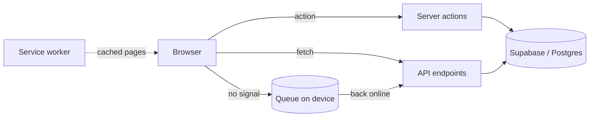

# BrewBrain OS

A web app that runs the day-to-day work of a small brewery.

Think about how most small breweries actually operate: a whiteboard by the fermenters, a spreadsheet for grain and hops, a shoebox of delivery notes, and a folder of paperwork that has to be sent to the tax office every month. BrewBrain OS puts all of that in one place. You log readings for each tank, track what is fermenting and for how long, keep an eye on stock and suppliers, and print the production reports you owe the regulator.


<p align="left">
  <a href="https://github.com/danilgorbunofff/BrewBrainOS/actions/workflows/ci.yml"></a>
  <a href="https://github.com/danilgorbunofff/BrewBrainOS/actions/workflows/playwright-a11y.yml"></a>
  <a href="https://github.com/danilgorbunofff/BrewBrainOS/actions/workflows/secrets-scan.yml"></a>
</p>

## Contents

- [Why I built it](#why-i-built-it)
- [What it does](#what-it-does)
- [Running it on your machine](#running-it-on-your-machine)
- [Settings it needs](#settings-it-needs)
- [The database](#the-database)
- [How it is built](#how-it-is-built)
- [Tests](#tests)
- [Putting it online](#putting-it-online)
- [Where to look first](#where-to-look-first)

## Why I built it

I kept running into the same scene in small breweries. Someone takes a reading from a tank, writes it on a scrap of paper, and later types it into a spreadsheet that nobody else can find. Grain goes out of date because no one updated the stock sheet. At the end of the month a manager spends an evening copying numbers into a government form.

Every part of that is a data entry problem, and data entry is what software is good at. So this is my attempt at the app I wanted to see: one that a brewer can use while standing in a cold room with gloves on, and that still works when the wifi drops out, which it always does.

The other reason is simpler. I wanted a project big enough to be interesting, with real users in mind, real constraints (offline, touch, small screens, actual regulations), and enough depth to be worth reading the code.

## What it does

**Tanks and batches.** Each physical tank gets a page: what is in it, which batch, when it was brewed, and every gravity and temperature reading over time, drawn as a trend line so you can see a stuck fermentation before it costs you a week. There is also a recipe section that scales ingredient amounts up or down and estimates bitterness.

**Logging without typing.** The feature I like most is voice logging. You hold the button, say something like "tank four, one oh four eight, nineteen degrees", and the app works out the tank, the gravity, the temperature and any note you spoke, then saves the reading. It uses Google's Gemini model for the transcription and extraction. In a noisy cellar it is much faster than tapping a number pad with wet fingers.

**It keeps working offline.** This was the constraint that shaped everything else. The app installs to a phone home screen, caches its own pages, and if you are out of signal it puts what you did into a queue on the device. When the connection comes back the queue empties by itself and you get a banner telling you what synced. Two browser tabs open at once will not send the same queued item twice.

**Stock, suppliers and waste.** Inventory tracks what is on hand and how it degrades. Dry goods lose freshness over time, so the app models that and warns you before a sack of malt is past its best. It also watches shrinkage: if the numbers say a keg should be half full but usage suggests otherwise, you get an alert. Suppliers can be rated, and purchase orders have a proper receiving step instead of a "mark as done" button.

**Paperwork.** Production reports come out as PDFs with the remarks the alcohol and tobacco tax office expects, so the month-end job becomes an export rather than an evening of copying. There are also daily operations, sanitation and yeast logs, plus a history of who changed what.

**Plans and billing.** The app has four plans, from a free tier up to a multi-site one, with real limits on tanks, batches per month, voice logging and reports. Subscriptions are handled by Stripe, and the limits are enforced on the server, not just hidden in the interface.

| Plan | Price | What you get |
| --- | --- | --- |
| Free | $0 | 2 tanks, 3 batches a month, no voice or compliance reports |
| Nanobrewery | $149 / month | 5 tanks, 10 batches a month |
| Production | $299 / month | Unlimited tanks and batches, voice logging, tax reports |
| Multi-Site | $599 / month | Everything above, plus more than one location |

A few smaller things worth knowing: QR labels on tanks and containers so you can open the right page by scanning, a "glove mode" that enlarges the buttons, push notifications for alerts, and a dark theme for anyone logging at five in the morning.

## Running it on your machine

You need Node.js 20 or newer, npm, and a Supabase account. Supabase is the hosted database and login service the app uses; the free tier is enough.

```bash
git clone https://github.com/danilgorbunofff/BrewBrainOS.git
cd BrewBrainOS
npm ci
cp .env.example .env.local
npm run dev
```

Then open <http://localhost:3000>.

**If you just want to look at the screens** and do not want to set up a database, the landing page and the login page work with any placeholder values:

```bash
NEXT_PUBLIC_SUPABASE_URL=https://placeholder.supabase.co \
NEXT_PUBLIC_SUPABASE_ANON_KEY=placeholder npm run dev
```

**If you want the full app**, make a project at [supabase.com](https://supabase.com), load the database migrations into it (see [the database](#the-database)), and put the project URL, the anon key and the service-role key into `.env.local`. Sign up at `/login`, answer the short onboarding questions about your brewery, and the dashboard opens.

Two commands worth knowing before you build: `npm run verify:env` tells you which settings are missing for a production build, and `npm run verify:env:server` does the same for the server-only ones. Both read `.env.local`, so run them after you fill it in. If you edit that file, restart the dev server.

## Settings it needs

Everything is listed with comments in `.env.example`. The ones that matter most:

| Setting | Who sees it | Needed for |
| --- | --- | --- |
| `NEXT_PUBLIC_SUPABASE_URL` | browser | Talking to your Supabase project |
| `NEXT_PUBLIC_SUPABASE_ANON_KEY` | browser | Login and normal database reads |
| `SUPABASE_SERVICE_ROLE_KEY` | server only | Payment webhooks and scheduled jobs |
| `STRIPE_SECRET_KEY` | server only | Subscriptions. The production build also reads it, so a build without it fails |
| `STRIPE_WEBHOOK_SECRET` | server only | Checking that Stripe sent a webhook |
| `GEMINI_API_KEY` | server only | Voice logging |
| `CRON_SECRET` | server only | Password for the scheduled endpoints |
| `SUPABASE_DB_URL` | local / CI only | Running the migrations from your machine |
| `E2E_TEST_USER_EMAIL` / `E2E_TEST_USER_PASSWORD` | local / CI only | The browser tests that log in |

Anything starting with `NEXT_PUBLIC_` ends up in the browser, so it must never hold a secret. The rest belong in your hosting provider's secret store or in GitHub Actions secrets, never in the repository. There are also optional settings for error reporting (Sentry), push notifications and a couple of development flags, all explained in `.env.example`.

## The database

The clean way in is `supabase/migrations/ordered/`, a numbered series from `001_init_core_tables.sql` to `010_rename_quantity_to_current_stock.sql`. Apply those in order and you have a working schema. Running `SUPABASE_DB_URL=your-connection-string npm run db:migrate:ordered` does it for you.

Two things to watch out for. `008_indexes_concurrent.sql` builds indexes without locking the tables and therefore has to run outside a transaction, which the script handles. And the older migrations in `supabase/migrations/` are kept for history only; `supabase/migrations/RECONCILIATION.md` explains how they map onto the ordered track, so you can ignore them for a fresh install.

Breweries are kept apart in the database itself. Every table carries the brewery it belongs to and row-level security policies decide what each signed-in user can read, so a mistake in a query cannot show one brewery another's numbers. The types for all of that are generated into `src/types/database.ts`.

## How it is built

It is a Next.js 16 app written in TypeScript, with React 19 on the front and Tailwind for styling. Supabase provides Postgres, authentication and row-level security. The offline side is a service worker generated by Serwist plus a queue stored in the browser. Payments go through Stripe, voice extraction through Gemini, errors are reported to Sentry, and charts are Recharts. Documents such as the tax reports are built with jsPDF.

```text
src/
├── app/
│   ├── (app)/       the signed-in app: dashboard, tanks, batches, inventory, …
│   ├── actions/     server-side functions the interface calls
│   ├── api/         endpoints: Stripe webhooks, scheduled jobs, sync, monitoring
│   ├── login/       sign-in, plus the public landing page
│   └── sw.ts        the service worker that makes offline mode work
├── components/      the interface, grouped by feature
├── lib/             the thinking: degradation, shrinkage, reordering,
│                    plans, the offline queue, voice parsing, validation
├── utils/supabase/  database clients for the browser, the server and middleware
└── types/           generated database types
supabase/migrations/ordered/   the schema, numbered
__tests__/                     unit and component tests
playwright/                    browser tests: smoke, accessibility, offline, speed
```

A reading that arrives while offline goes into the queue on the device and is sent by the same endpoint it would have used online, which keeps one code path instead of two:



## Tests

```bash
npm run lint     # code style
npm test         # 726 tests in 81 files
npm run build    # type check plus a production build
```

The Vitest suite covers the domain logic (how stock degrades, how shrinkage is spotted, how plans are enforced), the server-side functions and endpoints, and the fiddly components. Supabase and Stripe are stubbed out, so the tests run without network access.

The Playwright suites cover the parts you can only test in a real browser: signing in and creating a batch, keyboard and screen reader accessibility checks with axe, the offline fallback page, the queue replaying itself when the connection returns, and a scroll-speed benchmark on the 1,200-row inventory table.

CI runs all of it on every pull request: install, check the environment, lint, coverage tests, production build with bundle analysis, a check that the service worker's cache list is valid, then the browser suites. A separate workflow scans for leaked secrets and runs `npm audit` on `main`.

One gotcha, if you run the tests on a very new Node version: Node 25 ships an experimental global `localStorage` that shadows the one the tests expect, and storage tests fail with `localStorage.clear is not a function`. Node 20, which CI uses, is fine.

## Putting it online

Vercel is the simplest home for it, with Supabase as the database. Set the settings above in the dashboard, run the migrations against the production database before the first deploy, and point a Stripe webhook at `/api/stripe/webhook`.

Two endpoints are meant to be called on a schedule: `/api/cron/fermentation-alerts` and `/api/cron/recalculate-degradation`, both guarded by the `CRON_SECRET` setting. Vercel's cron jobs or any external scheduler will do. If you serve the app from somewhere other than Vercel, run `npm run verify:sw-precache` after building; it fails loudly if the offline cache is incomplete.

Security headers are set in `next.config.ts`, and [`SECURITY.md`](SECURITY.md) covers how secrets are handled and rotated.

## Where to look first

If you only have ten minutes, these are the files I would read.

- **Offline sync:** `src/lib/offlineQueue.ts` and `src/lib/offlineQueueShared.ts` hold the queue and its cross-tab lock, `src/components/OfflineSyncBanner.tsx` is what the user sees, `src/app/sw.ts` is the service worker.
- **Voice logging:** `src/app/actions/voice.ts`, `src/lib/voice-log.ts`, `src/components/VoiceLogger.tsx`.
- **Plans and paywalls:** `src/lib/tier-config.ts` is the single source of truth, used by both the pricing page and the server checks; `src/lib/require-brewery.ts` is where access is enforced.
- **Billing:** `src/app/api/stripe/`, `src/lib/stripeWebhook.ts`, and the row-level security policies in `supabase/migrations/ordered/009_rls_and_policies.sql`.
- **The brewing maths:** `src/lib/degradation.ts`, `src/lib/shrinkage.ts`, `src/lib/reorder.ts`, `src/lib/recipe-math.ts`.
- **Performance work:** `src/lib/table-virtualization.ts`, `src/components/InventoryTable.tsx` and its benchmark in `playwright/virtualization.benchmark.spec.ts`.

The tests are the fastest way to see how a feature is supposed to behave; `__tests__/lib` and `__tests__/api` read like descriptions of the rules.
