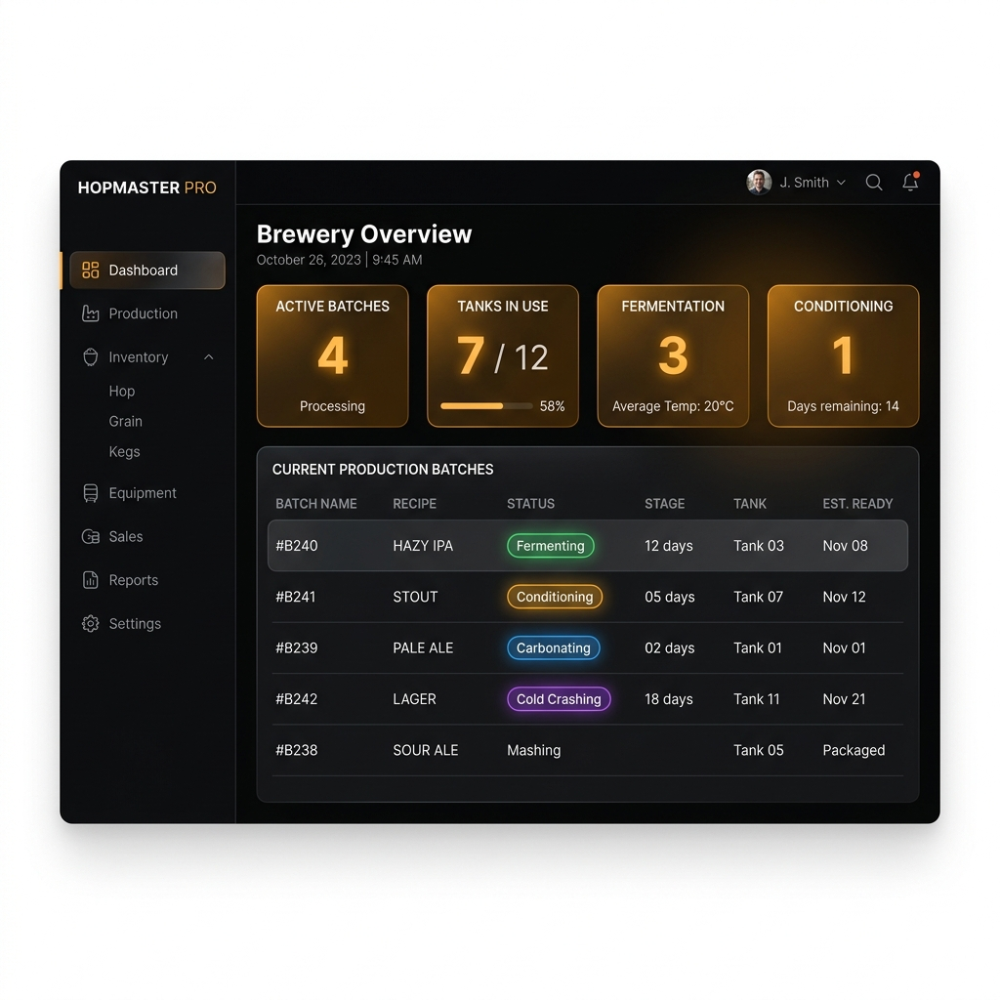

# BrewBrain OS

BrewBrain OS is a web app for running a small brewery. It keeps track of the tanks, the batches in them, the readings you take every day, what's in the storeroom, and the production reports you have to file with the tax office.

It was built to be used on the brewery floor: on a phone, with gloves on, in a cold room where the wifi doesn't reach. If the connection drops, the app keeps working and syncs when it can.



## Background

Most small breweries I've seen run on a whiteboard, a spreadsheet, and memory. Someone reads a gravity off a tank, writes it on a scrap of paper, and types it up later, if they remember. Grain expires because the stock sheet is out of date. At the end of the month an evening disappears into paperwork.

None of that is hard to fix with software. It's the kind of work software is actually good at: capture a number once, put it somewhere sensible, and show it back in a useful shape. So I built the app I'd want to use if I were the one carrying a hydrometer around all day.

## What it does

**Tanks.** Every vessel gets a page: what's in it, which batch, and a trend line of gravity and temperature so you can see a stuck fermentation forming instead of noticing it a week late.

**Voice logging.** Hold the button and say something like *"tank four, one oh four eight, nineteen degrees"*. The app works out the tank, the gravity and the temperature and saves the reading. That's Google's Gemini doing the extraction. It's a lot faster than tapping a number pad with wet hands.

**Working offline.** The app installs to a phone home screen and caches its own pages. Out of signal, anything you log goes into a queue on the device and is sent up when you're back online, with a banner telling you what synced. Two tabs open at once won't send the same item twice.

**Stock.** Inventory tracks what you have and how fast it ages. Dry goods lose freshness over time, so the app models that and warns you before the malt is past its best. It also flags shrinkage: if usage and stock levels don't add up, you hear about it.

**Suppliers and purchasing.** Supplier scorecards, purchase orders with a real receiving step, and a record of which supplier a batch's ingredients came from.

**Paperwork.** Production reports come out as PDFs with the remarks the regulator expects, so month end is an export rather than an evening of copying numbers. There are daily operations, sanitation and yeast logs too, plus a history of who changed what.

**Accounts and plans.** Four plans, from a free tier up to multi-site, with limits on tanks, batches per month, voice logging and reports. Payment runs through Stripe, and the limits are checked on the server rather than hidden in the interface.

| Plan | Price | Limits |
| --- | --- | --- |
| Free | $0 | 2 tanks, 3 batches a month |
| Nanobrewery | $149/month | 5 tanks, 10 batches a month |
| Production | $299/month | Unlimited, plus voice logging and reports |
| Multi-Site | $599/month | Everything, plus more than one location |

There are smaller things as well: QR labels so scanning opens the right tank, a "glove mode" with bigger buttons, push notifications for alerts, and a dark theme for the early shift.

## Running it

You need Node.js 20 or newer and npm. You'll also want a [Supabase](https://supabase.com) project, which provides the database and the login system. The free tier is enough.

```bash
git clone https://github.com/danilgorbunofff/BrewBrainOS.git
cd BrewBrainOS
npm ci
cp .env.example .env.local
npm run dev
```

Open <http://localhost:3000>.

If you only want to look at the screens, you don't need a database. The landing page and login page run with placeholder values:

```bash
NEXT_PUBLIC_SUPABASE_URL=https://placeholder.supabase.co \
NEXT_PUBLIC_SUPABASE_ANON_KEY=placeholder npm run dev
```

For the full app, create a Supabase project, load the migrations (see below), and put the project URL, the anon key and the service-role key into `.env.local`. Sign up at `/login`, answer the onboarding questions about your brewery, and the dashboard opens.

## Configuration

Everything is listed with comments in `.env.example`. The essentials:

- `NEXT_PUBLIC_SUPABASE_URL` and `NEXT_PUBLIC_SUPABASE_ANON_KEY` — your Supabase project. These reach the browser.
- `SUPABASE_SERVICE_ROLE_KEY` — server only. Used by webhooks and scheduled jobs.
- `STRIPE_SECRET_KEY` and `STRIPE_WEBHOOK_SECRET` — subscriptions. The production build reads the secret key, so a build without it fails.
- `GEMINI_API_KEY` — voice logging.
- `CRON_SECRET` — the password for the scheduled endpoints.
- `SUPABASE_DB_URL` — only needed to run migrations from your machine.

Anything starting with `NEXT_PUBLIC_` ends up in the browser, so never put a secret there. The rest belong in your host's secret store or in GitHub Actions secrets. `npm run verify:env` tells you what's missing before a build, and `npm run verify:env:server` does the same for server-only values.

## Database

`supabase/migrations/ordered/` is the clean way in: ten numbered files from `001_init_core_tables.sql` to `010_rename_quantity_to_current_stock.sql`. Run them in order, or let the script do it:

```bash
SUPABASE_DB_URL=your-connection-string npm run db:migrate:ordered
```

Two things to know. `008_indexes_concurrent.sql` builds indexes without locking tables, so it has to run outside a transaction, which the script handles. The older files in `supabase/migrations/` are kept for history only; `RECONCILIATION.md` there explains how they map onto the ordered ones.

Breweries are separated in the database itself. Every table carries its brewery, and row-level security decides what each signed-in user can read, so a mistake in a query can't show one brewery another's numbers.

## Tests

```bash
npm run lint     # linting
npm test         # 726 tests in 81 files
npm run build    # type check and production build
```

The unit tests cover the rules behind the app: how stock ages, how shrinkage is detected, how plan limits are enforced, plus the server actions, the API routes and the fiddly components. Supabase and Stripe are stubbed, so they run offline.

The Playwright tests need a real browser: signing in and creating a batch, keyboard and screen-reader checks with axe, the offline fallback page, the queue replaying itself, and a scroll-speed benchmark on a 1,200-row table.

CI runs all of it on every pull request, along with a check that the service worker's cache list is valid. Separate workflows scan for leaked secrets and run `npm audit`.

One gotcha: on Node 25 the tests fail with `localStorage.clear is not a function`. Node ships an experimental global `localStorage` there that shadows the one the tests expect. Use Node 20, which is what CI uses.

## Deploying

Vercel is the easy option, with Supabase as the database. Set the configuration above, run the migrations against the production database before the first deploy, and point a Stripe webhook at `/api/stripe/webhook`.

Two endpoints expect to be called on a schedule: `/api/cron/fermentation-alerts` and `/api/cron/recalculate-degradation`. Both check the `CRON_SECRET` setting, so pass it as a bearer token. Vercel cron or any external scheduler will do. If you host somewhere other than Vercel, run `npm run verify:sw-precache` after building; it fails if the offline cache is incomplete.

Security headers live in `next.config.ts`, and [`SECURITY.md`](SECURITY.md) explains how secrets are handled and rotated.

## Where to start reading

If you've got ten minutes, these are the parts worth your time:

- **Offline sync** — `src/lib/offlineQueue.ts` and `src/lib/offlineQueueShared.ts` hold the queue and its cross-tab lock, `src/components/OfflineSyncBanner.tsx` is the user-facing part, `src/app/sw.ts` is the service worker.
- **Voice logging** — `src/app/actions/voice.ts`, `src/lib/voice-log.ts`, `src/components/VoiceLogger.tsx`.
- **Plan limits** — `src/lib/tier-config.ts` is the single source of truth, used by the pricing page and the server checks. `src/lib/require-brewery.ts` is where access is enforced.
- **Billing** — `src/app/api/stripe/`, `src/lib/stripeWebhook.ts`, and the security policies in `supabase/migrations/ordered/009_rls_and_policies.sql`.
- **The brewing maths** — `src/lib/degradation.ts`, `src/lib/shrinkage.ts`, `src/lib/reorder.ts`, `src/lib/recipe-math.ts`.
- **Performance** — `src/lib/table-virtualization.ts`, `src/components/InventoryTable.tsx`, `playwright/virtualization.benchmark.spec.ts`.

The tests are the quickest way to see how something is meant to behave. `__tests__/lib` and `__tests__/api` read like descriptions of the rules.

## Stack

Next.js 16 with React 19 and TypeScript, Tailwind for styling, Supabase for Postgres, auth and row-level security. Offline support is a Serwist service worker plus a queue in the browser. Stripe handles billing, Gemini handles voice, Sentry reports errors, Recharts draws the charts, and jsPDF builds the reports.
