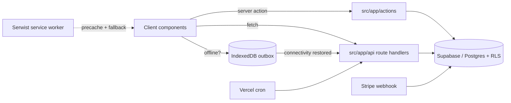

# BrewBrain OS

**Brewery operations, finally in one place.** BrewBrain OS replaces the whiteboard-and-spreadsheet workflow of a craft brewery with a single, offline-first web app: vessels and batches, gravity and temperature readings, inventory and suppliers, and the compliance paperwork that has to be filed at the end of the month.

Built for the cellar floor first — it works with wet hands, on a phone, in a cold room with no signal — and for the office second.


<p align="left">
  <a href="https://github.com/danilgorbunofff/BrewBrainOS/actions/workflows/ci.yml"></a>
  <a href="https://github.com/danilgorbunofff/BrewBrainOS/actions/workflows/playwright-a11y.yml"></a>
  <a href="https://github.com/danilgorbunofff/BrewBrainOS/actions/workflows/secrets-scan.yml"></a>
</p>

---

## Table of contents

- [What it does](#what-it-does)
- [Screens](#screens)
- [Tech stack](#tech-stack)
- [Architecture](#architecture)
- [Getting started](#getting-started)
- [Environment variables](#environment-variables)
- [Database](#database)
- [Scripts](#scripts)
- [Testing and quality gates](#testing-and-quality-gates)
- [Deployment](#deployment)
- [Design decisions](#design-decisions)
- [Notes for reviewers](#notes-for-reviewers)

## What it does

| Area | Capabilities |
| --- | --- |
| **Brewing floor** | Digital-twin tanks, batch lifecycle tracking, gravity/temperature readings with trend charts, brewing metrics, recipe scaling and IBU calculation, printable tank sheets |
| **Voice logging** | Hands-free reading capture: record a sentence ("tank 4, 1.048, 19 degrees"), Gemini extracts gravity, temperature, notes and batch, then the reading is written to the database — or queued if the device is offline |
| **Offline-first PWA** | Installable app shell, Serwist service worker with precache verification, IndexedDB outbox with a cross-tab processing lock, offline fallback page and a sync banner that flushes queued work when connectivity returns |
| **Inventory** | Stock levels, degradation curves per ingredient, shrinkage detection against baselines, reorder points and alerts, CSV import/export, per-item history |
| **Suppliers & purchasing** | Supplier scorecards, purchase orders with a dedicated receive flow, batch/ingredient provenance |
| **Compliance** | TTB-style production reports with PDF export and remarks, daily operations logs, sanitation and yeast logs, activity audit trail |
| **Analytics** | Dashboard KPIs, performance trends, supplier deep-dives, realtime refresh |
| **Billing** | Stripe subscriptions (Checkout, Customer Portal, idempotent webhooks) with tier enforcement on tanks, monthly batches, AI voice logs, TTB reports and multi-site access |
| **Platform** | Multi-tenant brewery scoping with Postgres RLS, QR scanning, glove mode, push notifications, command palette, dark mode, Sentry error reporting, Web Vitals monitoring, table virtualization above 100 rows |

### Plans

Tier definitions live in `src/lib/tier-config.ts` and drive both the pricing UI and server-side enforcement.

| Plan | Price | Tanks | Batches / month | AI voice | TTB reports | Multi-site |
| --- | --- | --- | --- | --- | --- | --- |
| Free | $0 | 2 | 3 | — | — | — |
| Nanobrewery | $149 / mo | 5 | 10 | — | — | — |
| Production | $299 / mo | unlimited | unlimited | ✓ | ✓ | — |
| Multi-Site | $599 / mo | unlimited | unlimited | ✓ | ✓ | ✓ |

## Screens

| Route | Purpose |
| --- | --- |
| `/` | Marketing landing page |
| `/login` | Supabase email auth |
| `/dashboard` | Daily overview: active batches, alerts, quick actions |
| `/tanks`, `/tank/[id]` | Vessel list and single-tank detail with readings and trends |
| `/batches`, `/batches/[id]` | Batch pipeline and batch detail |
| `/inventory`, `/inventory/[id]` | Stock, degradation and adjustment history |
| `/recipes`, `/recipes/[id]` | Recipes with ingredient scaling |
| `/suppliers`, `/purchase-orders` | Supplier scorecards and order receiving |
| `/compliance`, `/reports` | TTB report generation and export |
| `/shrinkage`, `/analytics` | Loss analysis and performance analytics |
| `/scan` | QR label scanning |
| `/settings` | Brewery profile, alerts, import, subscription |
| `/offline` | Offline fallback while disconnected |

The authenticated app lives in the `src/app/(app)` route group; server-side session refresh happens in `src/middleware.ts`.

## Tech stack

| Layer | Choice |
| --- | --- |
| Framework | Next.js 16 (App Router, Server Actions, Route Handlers) with React 19 |
| Language | TypeScript 5, strict mode |
| Styling | Tailwind CSS v4, shadcn/base-ui primitives, lucide icons, framer-motion |
| Data | Supabase (Postgres, Auth, RLS, Realtime) via `@supabase/ssr` |
| Offline | Serwist service worker, `idb-keyval` outbox |
| AI | Google Generative AI (Gemini) for voice extraction |
| Billing | Stripe subscriptions and webhooks |
| Observability | Sentry (browser + server), custom Web Vitals ingestion |
| Charts / documents | Recharts, jsPDF + autotable, Papaparse |
| Testing | Vitest + Testing Library (726 tests), Playwright (smoke, axe a11y, offline, benchmarks) |

## Architecture

```text
src/
├── app/
│   ├── (app)/          authenticated shell: dashboard, tanks, batches, inventory, …
│   ├── actions/        server actions (voice, readings, inventory, billing, dev)
│   ├── api/            route handlers: stripe webhooks, crons, iot ingest, sync
│   ├── login/, page.tsx  public entry points
│   └── sw.ts           Serwist service worker source
├── components/         UI, grouped by feature (tables, forms, gates, providers)
├── lib/                domain logic: degradation, shrinkage, reorder, tier config,
│                       offline queue, voice parsing, validation schemas, logger
├── utils/supabase/     browser / server / middleware clients
└── types/              generated database types
supabase/migrations/ordered/   canonical clean-install SQL track (001–010)
__tests__/              Vitest suites (api, components, lib, hooks, scripts)
playwright/             smoke, a11y and benchmark specs
```

**Request and sync flow**



Multi-tenancy is enforced in the database: every domain table is scoped to a `brewery_id` with row-level security, and the server never trusts a client-supplied brewery id (`src/lib/active-brewery.ts`).

## Getting started

**Prerequisites:** Node.js 20+ and npm, plus a Supabase project (the app is useless without one — see below).

```bash
git clone https://github.com/danilgorbunofff/BrewBrainOS.git
cd BrewBrainOS
npm ci
cp .env.example .env.local     # fill in the Supabase values at minimum
npm run dev                    # http://localhost:3000
```

### Minimum setup to click around

The landing page (`/`) and login screen are public and render with placeholder values, so a quick visual pass needs nothing more than:

```bash
NEXT_PUBLIC_SUPABASE_URL=https://placeholder.supabase.co \
NEXT_PUBLIC_SUPABASE_ANON_KEY=placeholder npm run dev
```

Everything behind auth needs a real Supabase project:

1. Create a project at [supabase.com](https://supabase.com).
2. Apply the ordered migrations to it (see [Database](#database)).
3. Put the project URL, anon key and service-role key into `.env.local`.
4. `npm run dev`, open `/login`, sign up, then complete the brewery onboarding.

`npm run verify:env` checks the values the build needs before you build; `npm run verify:env:server` checks the server-only secrets.

## Environment variables

`.env.example` is the canonical, commented map. The important ones:

| Variable | Scope | Required | Notes |
| --- | --- | --- | --- |
| `NEXT_PUBLIC_SUPABASE_URL` | public | yes | Supabase project URL |
| `NEXT_PUBLIC_SUPABASE_ANON_KEY` | public | yes | Browser-safe anon key |
| `NEXT_PUBLIC_SITE_URL` | public | no | Absolute URLs for auth redirects and Stripe |
| `SUPABASE_SERVICE_ROLE_KEY` | server | yes | Service-role client for webhooks and crons |
| `STRIPE_SECRET_KEY` | server | build + billing | Absent at build time, `npm run build` fails while collecting route data |
| `STRIPE_WEBHOOK_SECRET` | server | for webhooks | Signature verification |
| `STRIPE_PRICE_*` | server | for paid tiers | Monthly/annual price ids per plan |
| `GEMINI_API_KEY` | server | for voice logs | Google Generative AI key |
| `CRON_SECRET` | server | for crons | Bearer token for scheduled endpoints |
| `NEXT_PUBLIC_VAPID_PUBLIC_KEY`, `VAPID_PRIVATE_KEY`, `VAPID_SUBJECT` | mixed | for push | Web-push keys |
| `SENTRY_DSN`, `NEXT_PUBLIC_SENTRY_DSN`, `SENTRY_ENV`, `*_TRACES_SAMPLE_RATE` | mixed | no | Error reporting and tracing |
| `ENABLE_BENCHMARK_ROUTES`, `*_PERF_MONITORING` | mixed | no | Development/QA feature flags |
| `E2E_TEST_USER_EMAIL`, `E2E_TEST_USER_PASSWORD` | local/CI | for Playwright | Dedicated smoke-test account |
| `SUPABASE_DB_URL` | local/CI | for migrations | Target database for `npm run db:migrate:ordered` |

Rules of thumb: `NEXT_PUBLIC_*` is browser-visible and must never hold a secret; server-only values belong in your deployment secret manager or GitHub Actions secrets; restart `npm run dev` after editing env files.

## Database

- `supabase/migrations/ordered/` is the **canonical clean-install track** (`001_init_core_tables.sql` … `010_rename_quantity_to_current_stock.sql`). Use it for fresh environments.
- `supabase/migrations/` keeps the legacy feature migrations for reference; `supabase/migrations/RECONCILIATION.md` maps them onto the ordered track.
- `008_indexes_concurrent.sql` must be applied **outside** an explicit transaction.
- Apply with `SUPABASE_DB_URL=… npm run db:migrate:ordered`; CI validates the same path when `SUPABASE_MIGRATION_DB_URL` is configured.
- RLS policies live in `009_rls_and_policies.sql`; types are generated into `src/types/database.ts`.

## Scripts

| Command | What it does |
| --- | --- |
| `npm run dev` | Dev server (clears `.next` first to avoid stale Serwist output) |
| `npm run build` | Production build with Serwist service-worker generation |
| `npm run analyze` | Production build with the bundle analyzer (`ANALYZE=true`), then `npm run bundle:report` for the top-10 report |
| `npm start` | Serve the production build |
| `npm run lint` | ESLint over `src` |
| `npm test` | Full Vitest suite |
| `npm run test:coverage` | Coverage run (what CI enforces) |
| `npm run test:components` | Virtualized table component suites only |
| `npm run verify:env` / `:server` / `:smoke` / `:migrations` | Env preflight checks |
| `npm run db:migrate:ordered` | Apply the ordered SQL track |
| `npm run verify:sw-precache` | Fail if the built service worker has unhashed precache entries or no offline fallback |
| `npm run test:offline-precache` | Playwright: disconnected navigation is served from cache |
| `npm run test:offline-queue` | Playwright: queued voice logs flush, including the cross-tab lock |
| `npm run e2e:smoke:local` | Playwright smoke: login, batch creation, offline sync |
| `npm run test:a11y` | Playwright + axe accessibility suite |
| `npm run benchmark:virtualization` | Frame-timing benchmark for the 1,200-row inventory table |
| `npm run scan:secrets` / `:staged` | Gitleaks secret scan (also runs in the pre-commit hook) |

Development-only fixtures: `/dev/virtualization` (1,200 inventory rows, 900 batches) and the public `/benchmarks/virtualization` route used by the scroll benchmark.

## Testing and quality gates

```bash
npm run lint          # ESLint
npm test              # 81 files / 726 tests
npm run build         # type-check + production build
```

- **Unit and component tests** (Vitest + Testing Library + jsdom) cover server actions, API routes, domain logic, hooks and components. Supabase and Stripe clients are mocked; `__tests__/setup.ts` wires the shared matchers.
- **End-to-end** (Playwright) covers the smoke path, accessibility with axe, offline precache behaviour, offline queue replay, and scroll virtualization performance.
- **CI** (`.github/workflows/`) runs `npm ci` → env verification → lint → coverage tests → production build with the bundle analyzer → service-worker precache check → Playwright suites. Separate workflows run a gitleaks secret scan and `npm audit` on `main`.
- Tests are pinned to Node 20 in CI. Node 25 ships an experimental global `localStorage` that shadows the jsdom one and breaks storage tests — use Node 20 (or `nvm use 20`) if you see `localStorage.clear is not a function`.

## Deployment

The app targets Vercel (or any Node host that supports Next.js), with Supabase as managed Postgres/Auth.

1. Set the [environment variables](#environment-variables) in the hosting provider.
2. Point the Stripe webhook at `/api/stripe/webhook` and copy its signing secret into `STRIPE_WEBHOOK_SECRET`.
3. Schedule `/api/cron/fermentation-alerts` and `/api/cron/recalculate-degradation` with `Authorization: Bearer $CRON_SECRET`.
4. Run the ordered migrations against the production database before the first deploy.
5. `npm run verify:sw-precache` after the build if you serve the PWA from a custom host.

Security headers are configured in `next.config.ts`; secret rotation policy is documented in [`SECURITY.md`](SECURITY.md).

## Design decisions

A few choices worth calling out, since they shaped the codebase:

- **Offline is a first-class path, not an error state.** Every write that matters on the floor (voice logs, manual readings) can be captured into an IndexedDB outbox and replayed later, with a cross-tab lock so two tabs don't flush the same entry twice.
- **Multi-tenancy in the database.** RLS policies plus `requireActiveBrewery()` mean a bug in a query can't leak another brewery's data.
- **Tier gating server-side.** `tier-config.ts` is shared by the pricing UI and the server checks, so a limit can't be bypassed from the client.
- **Virtualize late, virtualize big.** Tables stay plain DOM up to 100 rows and switch to `@tanstack/react-virtual` beyond that — no virtualization tax on the common case, no jank on the 1,000-row import.
- **Compliance output is a product feature.** TTB reports export as PDF with the remarks the regulator expects, instead of telling the brewer to copy numbers into a form.
- **Glove mode and glove-sized targets**, because the primary user is standing in a wet cellar.

## Notes for reviewers

If you're skimming, these are the files that show the most interesting work:

| Area | Start here |
| --- | --- |
| Offline sync and the outbox | `src/lib/offlineQueue.ts`, `src/lib/offlineQueueShared.ts`, `src/components/OfflineSyncBanner.tsx`, `src/app/sw.ts` |
| Voice logging | `src/app/actions/voice.ts`, `src/lib/voice-log.ts`, `src/components/VoiceLogger.tsx` |
| Tier enforcement | `src/lib/tier-config.ts`, `src/lib/require-brewery.ts`, `src/components/TankLimitGate.tsx` |
| Billing and webhooks | `src/app/api/stripe/*`, `src/lib/stripeWebhook.ts`, `supabase/migrations/ordered/009_rls_and_policies.sql` |
| Domain logic | `src/lib/degradation.ts`, `src/lib/shrinkage.ts`, `src/lib/reorder.ts`, `src/lib/recipe-math.ts` |
| Performance work | `src/lib/table-virtualization.ts`, `src/components/InventoryTable.tsx`, `playwright/virtualization.benchmark.spec.ts` |

The test suite is the fastest way to understand behaviour: `__tests__/lib` and `__tests__/api` read like specifications.
